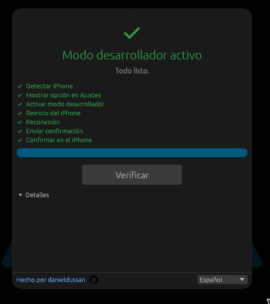

# ios-dev-mode

App de escritorio que te guía para mostrar y activar el **Modo de desarrollador** en un iPhone (iOS 16+), sin Mac ni Xcode. Hecha con Rust, [egui](https://github.com/emilk/egui) e [`idevice`](https://crates.io/crates/idevice).

Idiomas: Español · English · Português (se cambia en vivo desde el pie de la ventana). [Read in English](README.md)

<p align="center"></p>

## Qué hace

1. Detecta el iPhone por USB (modelo, versión de iOS y estado actual del modo desarrollador).
2. Hace aparecer el interruptor **Modo de desarrollador** en *Ajustes > Privacidad y seguridad*.
3. Vigila el teléfono mientras lo activas en Ajustes y el iPhone se reinicia. Sigue el reinicio, la reconexión y el desbloqueo, envía la confirmación y verifica el estado final.

No es 100% automático: el iPhone no se reinicia solo y, tras reiniciar, iOS pide tu código una vez. La app espera y te dice qué hacer en cada paso.

## Requisitos

- iPhone conectado por USB y **de confianza** en este equipo.
- **Windows:** iTunes (apple.com) o *Apple Devices* (Microsoft Store). Aportan el servicio `usbmuxd` en `127.0.0.1:27015`.
- **Linux:** el paquete `usbmuxd`. Se detiene cuando no hay teléfono y vuelve a arrancar al conectar uno.
- Rust 1.85+ solo si compilas desde el código fuente.

## Uso

Descarga el binario de tu sistema desde [Releases](../../releases) o ejecuta desde el código.

- **Windows:** ejecuta `ios-dev-mode-windows-x64.exe`.
- **Linux:** dale permiso de ejecución y ejecútalo (con el servicio `usbmuxd` disponible):

  ```
  chmod +x ios-dev-mode-linux-x64
  ./ios-dev-mode-linux-x64
  ```

Desde el código:

```
cargo run --release
cargo run -- --mock     # probar la interfaz sin teléfono
```

Flujo típico:

1. Conecta el iPhone, desbloquéalo y toca **Confiar**.
2. Pulsa **Activar**. La app muestra la opción en Ajustes.
3. En el iPhone: *Ajustes > Privacidad y seguridad > Modo de desarrollador*, actívalo y toca **Reiniciar** cuando el iPhone te lo pida.
4. Tras el reinicio, desbloquea con tu código y toca **Activar** cuando lo pida.
5. La app lo detecta y muestra *Modo desarrollador activo*. Si no avanza, pulsa **Verificar ahora**.

## Probado

| Dispositivo | iOS | Resultado |
|---|---|---|
| iPhone XR | 18.7.9 | Flujo completo: mostrar opción, activación manual y reinicio, código, confirmación, éxito |
| iPhone 13 | 27.0.1 | Lectura de estado con el teléfono bloqueado, modo ya activo |

El comportamiento en iOS 16/17 no está probado (`reveal` y `enable` están documentados para iOS 18+). Si fallan, la app pasa a instrucciones manuales y sigue verificando el estado.

## Compilar

```
cargo build --release
cargo test && cargo clippy --all-targets -- -D warnings && cargo fmt --check
cargo run --example spike -- status   # sonda por consola con un teléfono real
```

`idevice` está fijado a `=0.1.68`: trae cambios incompatibles en cada versión menor hasta la 0.2.0. El TLS usa la feature `ring` para que en Windows no haga falta cmake ni NASM.

## Notas

- Windows puede mostrar un aviso de SmartScreen porque el `.exe` no está firmado.
- No está afiliado a Apple. Úsalo en tus propios dispositivos.

## Licencia

[MIT](LICENSE) · hecho por [danieldussan](https://github.com/danieldussan)
